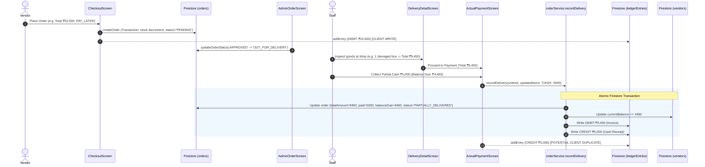

# DMS Codebase Financial & Ledger Workflow Audit Report

**Target Workspace:** `d:\Inventory`  
**Application Name:** Distributor Management System (DMS)  
**Stack:** React Native (Expo SDK 57/React 19), TypeScript, Firebase Firestore & Auth, Zustand  
**Audit Scope:** Read-Only Forensic Architecture, Accounting Logic, Data Consistency, & UX Redundancy Analysis

---

## 1. Executive Summary

The application is a multi-role B2B Distributor & Inventory Management System (DMS) serving three personas:
1. **Admin (Distributor HQ)**: Oversees product stock, order fulfillment, credit terms, financial ledgers, cash handovers, and system audit logs.
2. **Field Delivery Staff**: Executes routes, delivers goods, records item discrepancies (missing/damaged), collects counter payments, and submits daily cash settlements.
3. **Retail Vendor (Shop Owner)**: Places wholesale catalog orders, selects payment terms (Pay Later / Cash / UPI), monitors delivery status, and tracks their customer statement (Khata).

### Current State of the Ledger & Finance Engine
* **Accounting Paradigm**: The application implements a **Single-Party Running Balance Ledger (Digital Khata)**. It is **not** a double-entry general ledger. Each ledger document in the `ledgerEntries` collection represents a single statement line for a specific party (`partyId`), recording debits (goods sold/invoiced) and credits (cash/online collections).
* **Core Strengths**: 
  - Real-time synchronization using Zustand + Firestore snapshot listeners.
  - Multi-step delivery verification with automatic tax/subtotal recalculation for damaged goods.
  - Mandatory reason-based audit trails for manual adjustments with immutable Firestore security rules.
  - Granular Cash Settlement workflow with variance calculation (shortage/excess) and admin verification.
* **Critical Architectural Gaps & Risks**:
  - **Duplicate Entry Hazard**: Both `CheckoutScreen.tsx`/`ActualPaymentScreen.tsx` (UI tier) and `orderService.ts:recordDelivery` (data tier) independently attempt to write debit/credit ledger records.
  - **Hardcoded Baselines**: Staff cash in hand (`useCashStore.ts`) uses a hardcoded initial baseline constant (`6888`).
  - **Unenforced Credit Limits**: Although `creditLimit` is defined in `Vendor` types, orders are placed without checking outstanding debt against credit limits.
  - **Metric Inaccuracies**: Admin dashboard calculates receivables by summing all historical debit amounts rather than current outstanding running balances.
  - **Missing Standalone Collections**: `payments` and `invoices` collections are defined in security rules and types but do not have dedicated services or persistence layers (payments exist only inside orders and ledger entries).

---

## 2. Project Structure & Component Inventory

| Component / Layer | Exact File Path | Purpose | Implementation Status | Related Components |
| :--- | :--- | :--- | :--- | :--- |
| **Admin Dashboard** | [`src/screens/admin/AdminDashboardScreen.tsx`](file:///d:/Inventory/src/screens/admin/AdminDashboardScreen.tsx) | HQ overview of alerts, pending settlements, low stock, and total receivables. | **Implemented** (Calculation metric bug in receivables) | `useLedgerStore`, `useInventoryStore`, `useCashStore`, `useOrderStore` |
| **Admin Finance** | [`src/screens/admin/AdminFinanceScreen.tsx`](file:///d:/Inventory/src/screens/admin/AdminFinanceScreen.tsx) | Aggregated vendor receivables, supplier payables, and net working capital. | **Implemented** | `useLedgerStore`, `useInventoryStore`, `useVendorStore`, `VendorDetailScreen` |
| **Vendor Detail & Khata** | [`src/screens/admin/VendorDetailScreen.tsx`](file:///d:/Inventory/src/screens/admin/VendorDetailScreen.tsx) | Admin view of vendor profile, Khata toggle, transaction list, and manual edit modal. | **Implemented** | `LedgerSummaryCard`, `LedgerRow`, `LedgerAdjustmentModal`, `useVendorStore` |
| **Vendor List** | [`src/screens/admin/VendorListScreen.tsx`](file:///d:/Inventory/src/screens/admin/VendorListScreen.tsx) | Directory of all retail shops with quick due balance indicators. | **Implemented** | `useVendorStore`, `useLedgerStore` |
| **Admin Orders** | [`src/screens/admin/AdminOrdersScreen.tsx`](file:///d:/Inventory/src/screens/admin/AdminOrdersScreen.tsx) | Order queue with status tabs (Pending, Approved, Out for Delivery, Delivered). | **Implemented** | `useOrderStore`, `AdminOrderDetailScreen` |
| **Admin Order Detail** | [`src/screens/admin/AdminOrderDetailScreen.tsx`](file:///d:/Inventory/src/screens/admin/AdminOrderDetailScreen.tsx) | Detailed invoice breakdown, status override actions (Approve, Reject, Dispatch). | **Implemented** | `StatusTracker`, `OrderItemRow`, `useOrderStore` |
| **Staff Settlements (Admin)** | [`src/screens/admin/StaffSettlementsScreen.tsx`](file:///d:/Inventory/src/screens/admin/StaffSettlementsScreen.tsx) | Admin audit queue to verify/approve end-of-day staff cash handovers. | **Implemented** | `useCashStore`, `SettlementDetailModal`, `StatusBadge` |
| **Audit History** | [`src/screens/admin/AuditHistoryScreen.tsx`](file:///d:/Inventory/src/screens/admin/AuditHistoryScreen.tsx) | Immutable security log viewer for ledger adjustments and override actions. | **Implemented** | `useLedgerStore`, `ledgerService` |
| **Supplier Screen** | [`src/screens/admin/SupplierScreen.tsx`](file:///d:/Inventory/src/screens/admin/SupplierScreen.tsx) | Supplier directory, procurement tracking, and payable balance management. | **Implemented** | `useInventoryStore`, `supplierService` |
| **Inventory Screen** | [`src/screens/admin/InventoryScreen.tsx`](file:///d:/Inventory/src/screens/admin/InventoryScreen.tsx) | SKU management, pricing, low-stock threshold alerts, and batch refill. | **Implemented** | `useInventoryStore`, `BulkRefillModal` |
| **Vendor Ledger (Khata)** | [`src/screens/vendor/VendorLedgerScreen.tsx`](file:///d:/Inventory/src/screens/vendor/VendorLedgerScreen.tsx) | Vendor self-service account statement with Billed/Paid filters & running balance. | **Implemented** | `LedgerSummaryCard`, `LedgerRow`, `useLedgerStore`, `useAuthStore` |
| **Vendor Checkout** | [`src/screens/vendor/CheckoutScreen.tsx`](file:///d:/Inventory/src/screens/vendor/CheckoutScreen.tsx) | Cart checkout, payment method selection (Pay Later / Cash / UPI), order dispatch. | **Implemented** (Double-entry risk with `recordDelivery`) | `useCartStore`, `useOrderStore`, `useLedgerStore` |
| **Vendor Dashboard** | [`src/screens/vendor/VendorDashboardScreen.tsx`](file:///d:/Inventory/src/screens/vendor/VendorDashboardScreen.tsx) | Vendor home showing current balance, active orders, and catalog quick-links. | **Implemented** | `useOrderStore`, `useLedgerStore`, `useVendorStore` |
| **Vendor Orders / Detail** | [`src/screens/vendor/VendorOrdersScreen.tsx`](file:///d:/Inventory/src/screens/vendor/VendorOrdersScreen.tsx), [`VendorOrderDetailScreen.tsx`](file:///d:/Inventory/src/screens/vendor/VendorOrderDetailScreen.tsx) | Vendor order history, live fulfillment tracking, and itemized invoice details. | **Implemented** | `OrderCard`, `StatusTracker`, `OrderItemRow` |
| **Delivery Detail (Staff)** | [`src/screens/staff/DeliveryDetailScreen.tsx`](file:///d:/Inventory/src/screens/staff/DeliveryDetailScreen.tsx) | Quantity stepper for delivered vs damaged goods, real-time bill recalculation. | **Implemented** | `ProductQuantityCard`, `BillSummaryCard`, `PaymentCollectionButton` |
| **Actual Payment (Staff)** | [`src/screens/staff/ActualPaymentScreen.tsx`](file:///d:/Inventory/src/screens/staff/ActualPaymentScreen.tsx) | On-the-spot payment recording (Cash / Online / Pay Later / Partial) with order completion. | **Implemented** (Redundant ledger write) | `useOrderStore`, `useLedgerStore`, `orderService` |
| **Cash Settlement (Staff)** | [`src/screens/staff/CashSettlementScreen.tsx`](file:///d:/Inventory/src/screens/staff/CashSettlementScreen.tsx) | Staff end-of-day reconciliation: expected cash vs handed over cash, variance calculation. | **Implemented** | `useCashStore`, `ConfirmationModal`, `SettlementSuccessView` |
| **Ledger Store** | [`src/store/useLedgerStore.ts`](file:///d:/Inventory/src/store/useLedgerStore.ts) | Client state for ledger entries, audit logs, running balance calculations, manual adjustments. | **Implemented** | `ledgerService`, `mockData` |
| **Cash Store** | [`src/store/useCashStore.ts`](file:///d:/Inventory/src/store/useCashStore.ts) | State for staff settlements, cash-in-hand calculations, admin verification. | **Implemented** (Hardcoded 6888 baseline) | `settlementService`, `mockData` |
| **Order Store** | [`src/store/useOrderStore.ts`](file:///d:/Inventory/src/store/useOrderStore.ts) | State for order lifecycle, delivery completion, status updates. | **Implemented** | `orderService`, `mockData` |
| **Vendor Store** | [`src/store/useVendorStore.ts`](file:///d:/Inventory/src/store/useVendorStore.ts) | State for vendor profiles, Pay Later eligibility toggle. | **Implemented** | `vendorService` |
| **Ledger Service** | [`src/services/ledgerService.ts`](file:///d:/Inventory/src/services/ledgerService.ts) | Firestore operations for ledger querying, subscriptions, manual edits, and audit logs. | **Implemented** | `db` (Firestore) |
| **Order Service** | [`src/services/orderService.ts`](file:///d:/Inventory/src/services/orderService.ts) | Firestore transactions for atomic order creation and delivery/ledger completion. | **Implemented** | `db` (Firestore) |
| **Settlement Service** | [`src/services/settlementService.ts`](file:///d:/Inventory/src/services/settlementService.ts) | Firestore operations for cash settlement submission and admin verification. | **Implemented** | `db` (Firestore) |
| **Firestore Rules** | [`firestore.rules`](file:///d:/Inventory/firestore.rules) | Role-based read/write access and immutable constraints on `auditLogs` and `ledgerEntries`. | **Implemented** | Firebase Auth & Firestore |
| **Domain Types** | [`src/types/index.ts`](file:///d:/Inventory/src/types/index.ts) | TypeScript interfaces for User, Vendor, Product, Order, LedgerEntry, Settlement, AuditLog. | **Implemented** | Entire App |
| **Business Constants** | [`src/constants/rules.ts`](file:///d:/Inventory/src/constants/rules.ts) | 5% GST tax rate, payment method labels, order status themes. | **Implemented** | Components & Screens |

---

## 3. Current Ledger Implementation

### 3.1 Ledger Architecture

```
                                  ┌───────────────────────────────┐
                                  │      `ledgerEntries` Doc      │
                                  ├───────────────────────────────┤
                                  │ partyId (Vendor / Supplier)   │
                                  │ type: 'DEBIT' | 'CREDIT'      │
                                  │ amount: number                │
                                  │ runningBalance: number        │
                                  │ referenceNo: 'ORD-..'/'RCPT-' │
                                  │ orderId: string               │
                                  │ createdBy: string             │
                                  │ createdRole: 'ADMIN'|'STAFF'  │
                                  └───────────────────────────────┘
```

* **Creation Mechanism**:
  - Automatically via `orderService.recordDelivery` (creates both `DEBIT` for invoice and `CREDIT` for collected payment inside a single Firestore transaction).
  - Automatically via `CheckoutScreen.tsx:handlePlaceOrder` (creates a `DEBIT` entry when `PAY_LATER` is selected).
  - Automatically via `ActualPaymentScreen.tsx:handleConfirmDeliveryAndPayment` (creates a `CREDIT` entry when staff collects cash/online).
  - Manually via `useLedgerStore.addEntry` / `ledgerService.addEntry`.
* **Debit Trigger (`DEBIT` = Vendor owes distributor)**:
  - Placement of a `PAY_LATER` order (in `CheckoutScreen.tsx`).
  - Fulfillment of an order invoice (in `orderService.ts:recordDelivery`).
* **Credit Trigger (`CREDIT` = Vendor pays distributor)**:
  - Delivery collection of cash/online payments (in `ActualPaymentScreen.tsx` & `orderService.ts`).
* **Order & Invoice Linking**:
  - `orderId` is attached to `LedgerEntry`.
  - `referenceNo` stores the `orderNumber` (e.g., `ORD-2026-4402`) or receipt ID (e.g., `RCPT-7821`).
  - **Invoices**: NOT a standalone Firestore document; the invoice is represented by the order document itself + the corresponding `DEBIT` ledger entry.
* **Vendor & Supplier Linking**:
  - Linked via `partyId`, `partyName`, `partyType` (`'VENDOR'` | `'SUPPLIER'`), `accountId`, `accountType`.
* **Staff Settlement Linking**:
  - **NOT LINKED**: Staff cash settlements (`cashSettlements`) are NOT linked to vendor ledger entries. Settlements represent an internal handover between staff and HQ, whereas ledger entries represent trade credit between distributor and vendor/supplier.
* **Opening & Closing Balances**:
  - **Opening Balance**: NOT explicitly modeled as a distinct transaction event or balance initialization document. It falls back to `vendor.currentBalance` or initial mock balance if no ledger entries exist.
  - **Closing Balance**: NOT computed as a formal accounting period close; it is represented by the latest entry's `runningBalance`.
* **Running Balance Computation**:
  - Computed on the **client / application service layer** during entry insertion:
    $$\text{runningBalance}_{\text{new}} = \text{runningBalance}_{\text{prev}} + (\text{type} == \text{'DEBIT'} \text{ ? } \text{amount} : -\text{amount})$$
  - Stored inside each document in `ledgerEntries`.
* **Accounting Model Classification**:
  - **Single-Party Running Balance Ledger (Digital Khata)**. It tracks running balances per counterparty. It is not general-ledger double entry (no separate Asset, Liability, Equity, Revenue, Expense debit/credit splits).
* **Immutability & Editability**:
  - Firestore security rules explicitly forbid document deletion (`allow delete: if false`).
  - Admins can edit the `amount` of historical entries using `adjustLedgerManual`, which enforces a mandatory `reason`, updates `editedAt`, `editedBy`, `editReason`, and generates an append-only audit record in `auditLogs`.

---

### 3.2 Admin Ledger Capabilities

| Action | Supported? | Actual Code Mechanism & Workflow |
| :--- | :---: | :--- |
| **View** | ✅ YES | In [`AdminFinanceScreen.tsx`](file:///d:/Inventory/src/screens/admin/AdminFinanceScreen.tsx) (aggregated list) and [`VendorDetailScreen.tsx`](file:///d:/Inventory/src/screens/admin/VendorDetailScreen.tsx) (full itemized list of vendor transactions with running balance). |
| **Create** | ✅ YES | Supported via `useLedgerStore.addEntry` and `ledgerService.addEntry`. |
| **Edit** | ✅ YES | Admin taps any entry on [`VendorDetailScreen.tsx`](file:///d:/Inventory/src/screens/admin/VendorDetailScreen.tsx) ➔ Opens [`LedgerAdjustmentModal.tsx`](file:///d:/Inventory/src/components/ledger/LedgerAdjustmentModal.tsx) ➔ Enforces mandatory reason ➔ Executes Firestore transaction in `ledgerService.adjustLedgerManual` ➔ Generates `auditLogs` record. |
| **Delete** | ❌ NO | Prohibited by design in `firestore.rules` (Line 92: `allow delete: if false`). |
| **Approve** | ❌ NO | Ledger entries do not have approval states (they are committed immediately upon generation). |
| **Verify** | ⚠️ PARTIAL | Cash handovers from staff are verified in [`StaffSettlementsScreen.tsx`](file:///d:/Inventory/src/screens/admin/StaffSettlementsScreen.tsx), but vendor ledger transactions do not have a verification state. |
| **Reconcile**| ❌ NO | No bank statement or manual payment reconciliation tool exists. |
| **Adjust** | ✅ YES | Via `LedgerAdjustmentModal` with audit tracking. |

---

### 3.3 Vendor Ledger Capabilities

| Action | Supported? | Actual Code Mechanism & Workflow |
| :--- | :---: | :--- |
| **View** | ✅ YES | In [`VendorLedgerScreen.tsx`](file:///d:/Inventory/src/screens/vendor/VendorLedgerScreen.tsx). Shows running balance, total billed, total paid, and segmented filters (`All`, `Billed (Orders)`, `Paid (Payments)`). |
| **Create** | ❌ NO | Vendors cannot create arbitrary ledger entries. Placing a `PAY_LATER` order auto-generates a debit entry. |
| **Edit / Delete** | ❌ NO | Prohibited by `firestore.rules` and UI. |
| **Pay Online** | ❌ NO | No online payment gateway integration (Razorpay, Stripe, UPI Intent). Payment method is recorded as a descriptor only. |
| **Download PDF/Statement** | ❌ NO | NOT IMPLEMENTED. |
| **Dispute Entry** | ❌ NO | NOT IMPLEMENTED. |
| **Request Statement** | ❌ NO | NOT IMPLEMENTED. |

---

## 4. Order ➔ Delivery ➔ Payment ➔ Ledger Flow

### Detailed Tracing of Business Scenarios



---

### Scenario Analysis & Codebase Findings

#### Scenario A: Vendor places a Pay Later order and pays partially at delivery
1. **Order Placement**: [`CheckoutScreen.tsx:59-97`](file:///d:/Inventory/src/screens/vendor/CheckoutScreen.tsx#L59-L97). `createOrder` runs in a transaction decrements product stock. If `selectedPaymentMode === 'PAY_LATER'`, `CheckoutScreen` calls `addEntry` to create a `DEBIT` entry for `totalAmount`.
2. **Admin Approval**: [`AdminOrderDetailScreen.tsx:64-90`](file:///d:/Inventory/src/screens/admin/AdminOrderDetailScreen.tsx#L64-L90). Admin updates order status to `APPROVED` and `OUT_FOR_DELIVERY`.
3. **Delivery Execution**: [`DeliveryDetailScreen.tsx:55-88`](file:///d:/Inventory/src/screens/staff/DeliveryDetailScreen.tsx#L55-L88). Staff steps item quantity down if items are missing/damaged. Subtotal and 5% GST are recalculated in real time.
4. **Payment Recording**: [`ActualPaymentScreen.tsx:56-102`](file:///d:/Inventory/src/screens/staff/ActualPaymentScreen.tsx#L56-L102). Staff selects actual payment mode, enters collected amount (e.g., partial amount), and triggers `orderService.recordDelivery`.
5. **Inconsistency / Double-Write Defect Detected**:
   - In `orderService.ts:231-291`, `recordDelivery` executes a Firestore transaction that writes a `DEBIT` entry for the final delivered invoice AND a `CREDIT` entry for the paid amount, updating `vendor.currentBalance`.
   - Simultaneously, `ActualPaymentScreen.tsx:77-92` executes `addEntry` to write a client/store `CREDIT` entry.
   - Furthermore, `CheckoutScreen.tsx:83-97` *already* wrote a `DEBIT` entry at order placement.
   - **Result**: The vendor gets billed **TWICE** (once at order placement and once at delivery) and credited **TWICE** (once in `orderService` and once in `ActualPaymentScreen`).

#### Scenario B: Cash Collection & Staff Settlement Flow
1. **Cash Collection**: Collected during delivery (`paidAmount` recorded on `orders` and `ledgerEntries`).
2. **Staff Cash-in-Hand Calculation**: [`useCashStore.ts:26-54`](file:///d:/Inventory/src/store/useCashStore.ts#L26-L54). Computes:
   $$\text{Cash In Hand} = \text{baselineCollections (6888)} + \sum \text{Delivered Cash Orders} - \sum \text{Handed Over Settlements}$$
   *Notice:* The hardcoded `6888` baseline is a testing artifact that skews real production balances.
3. **Settlement Submission**: [`CashSettlementScreen.tsx:87-107`](file:///d:/Inventory/src/screens/staff/CashSettlementScreen.tsx#L87-L107). Staff enters actual cash handed over. Variance ($\text{Handed Over} - \text{Expected}$) is calculated. Document created in `cashSettlements` with status `'PENDING_VERIFICATION'`.
4. **Admin Verification**: [`StaffSettlementsScreen.tsx:29-32`](file:///d:/Inventory/src/screens/admin/StaffSettlementsScreen.tsx#L29-L32). Admin reviews expected vs handed-over amounts and clicks "Verify & Approve Settlement", updating status to `'VERIFIED'`.

#### Scenario C: Partial Delivery, Damaged Goods, and Returns
1. **Quantity Discrepancy Handling**: In `DeliveryDetailScreen.tsx`, reducing `deliveredQty` automatically increments `missingDamagedQty`.
2. **Bill Recalculation**: Subtotal and 5% tax dynamically scale strictly to delivered units.
3. **Status Assignment**: If any item has `missingDamagedQty > 0`, the order is marked `'PARTIALLY_DELIVERED'`; otherwise `'DELIVERED'`.
4. **Inventory Re-stocking of Missing/Damaged Goods**:
   - **GAP DETECTED**: In `orderService.ts:createOrder`, stock is deducted for the full *ordered* quantity. When `recordDelivery` is called with missing/damaged quantities, the undelivered items are **NOT** added back to product inventory or transferred to a damaged goods inventory location. Stock remains permanently deducted!

---

## 5. Firestore Data Model & Security Rules Audit

### Collections Overview

| Collection Name | Document ID Pattern | Key Fields | Created By | Updated By | Core Relationships | Security Rules Constraints |
| :--- | :--- | :--- | :--- | :--- | :--- | :--- |
| `users` | Auth UID | `name`, `phone`, `email`, `role`, `vendorId`, `staffId` | User on Signup | Admin / User (non-role fields) | Links Auth to `vendors` or `staff` | Role modification blocked for non-admins |
| `vendors` | Auto-ID | `shopName`, `name`, `phone`, `address`, `currentBalance`, `payLaterEligible`, `creditLimit` | Admin | Admin / Vendor (limited profile keys) | Referenced by `orders.vendorId`, `ledgerEntries.partyId` | Vendors cannot edit `currentBalance` or `creditLimit` |
| `products` | Auto-ID | `name`, `category`, `sku`, `price`, `stockQty`, `lowStockThreshold`, `supplierId` | Admin / Staff | Admin / Staff | Referenced by `orders.items[].productId` | Write allowed for Admin and Staff |
| `suppliers` | Auto-ID | `name`, `contactPerson`, `phone`, `balancePayable`, `category` | Admin | Admin | Referenced by `products.supplierId`, `ledgerEntries.partyId` | Write restricted to Admin |
| `orders` | Auto-ID | `orderNumber`, `vendorId`, `items[]`, `subtotal`, `tax`, `totalAmount`, `status`, `paidAmount`, `balanceDue`, `assignedStaffId` | Vendor / Admin | Admin / Staff / Vendor (if `PENDING`) | `vendorId` ➔ `vendors`, `items[].productId` ➔ `products`, `assignedStaffId` ➔ `users` | Vendors can only update their own `PENDING` orders |
| `ledgerEntries` | Auto-ID | `partyId`, `partyName`, `partyType`, `type` (`DEBIT`/`CREDIT`), `amount`, `runningBalance`, `referenceNo`, `orderId`, `createdBy`, `editedAt`, `editReason` | Admin / Staff / Vendor | Admin (audit edit fields only) | `partyId` ➔ `vendors`/`suppliers`, `orderId` ➔ `orders` | **Deletions strictly forbidden (`allow delete: if false`)**. Edits restricted to Admin with audit fields |
| `cashSettlements`| Auto-ID | `settlementNumber`, `staffId`, `staffName`, `date`, `totalCashCollected`, `handedOverCash`, `variance`, `status`, `verifiedBy` | Staff / Admin | Admin | `staffId` ➔ `users` | Staff creates; Admin verifies |
| `auditLogs` | Auto-ID | `action`, `performedBy`, `userRole`, `entityType`, `entityId`, `timestamp`, `reason`, `details` | Admin | **None (Immutable)** | `entityId` ➔ `ledgerEntries` | **Deletions and updates strictly forbidden (`allow update, delete: if false`)** |
| `payments` | — | Defined in types/rules but **no documents are written to this collection** in codebase | — | — | — | Rules exist in `firestore.rules` (lines 80-85), but collection is unutilized |
| `invoices` | — | **Not present in Firestore** | — | — | — | Orders serve as implicit invoices |

---

## 6. Current Feature Inventory

### A. ALREADY IMPLEMENTED (Verified in Source Code)
1. **Role-Based Portals**: Dedicated navigators and role switching for Admin, Staff, and Vendor (`RootNavigator.tsx`).
2. **Single-Party Running Balance Ledger**: Real-time statement for vendors and suppliers tracking debits, credits, and running balances (`ledgerService.ts`, `useLedgerStore.ts`).
3. **Manual Ledger Adjustment with Mandatory Audit Reason**: Admin can adjust historical transaction amounts; changes require an audit reason and write to `auditLogs` (`ledgerService.ts:adjustLedgerManual`).
4. **Immutable Audit Trail**: Firestore security rules enforce append-only `auditLogs` and forbid deletion of `ledgerEntries` (`firestore.rules`).
5. **Staff End-of-Day Cash Settlement**: Staff can submit handover amounts with live variance detection; Admin can verify settlements (`CashSettlementScreen.tsx`, `StaffSettlementsScreen.tsx`).
6. **Multi-Item Order Quantity Verification at Delivery**: Stepper controls to adjust delivered vs missing/damaged units with real-time tax and total recalculation (`DeliveryDetailScreen.tsx`).
7. **Credit (Pay Later) Eligibility Toggle**: Admin can enable/disable credit ordering per vendor (`VendorDetailScreen.tsx`, `vendorService.ts`).
8. **Real-time Cross-Device Sync**: Real-time Firestore snapshot listeners for orders, inventory, vendors, settlements, and ledgers (`useOrderStore`, `useLedgerStore`, etc.).

### B. PARTIALLY IMPLEMENTED (UI exists but backend/logic is incomplete)
1. **Vendor Credit Limit Enforcement**: `creditLimit` field exists in TypeScript interfaces and mock data, but is **never checked** during order placement in `orderService.ts:createOrder`.
2. **Supplier Ledger & Payables**: `AdminFinanceScreen` displays supplier payables and `supplierService` manages supplier records, but goods receipts / purchase bills do not generate automated supplier ledger entries.
3. **Payment Collection**: Payment method and collected amount are stored inside order documents and ledger entries, but the dedicated `payments` Firestore collection is unused.
4. **Staff Cash In Hand**: Calculation is functioning in UI, but relies on a hardcoded test constant `6888` in `useCashStore.ts`.
5. **Admin Receivables KPI**: Admin dashboard displays "Vendor Receivables" by summing all historical debit entries rather than actual outstanding debt balances (`AdminDashboardScreen.tsx:40-42`).

### C. NOT IMPLEMENTED (Missing Features)
1. **Invoice PDF / Print / Share Generation**: No PDF generation or invoice export capability.
2. **Payment Gateway Integration**: No actual digital payment integration (Razorpay, UPI intent, card processing).
3. **Formal Invoices Collection**: Invoices are not independent entities with lifecycle states (Issued, Overdue, Cancelled, Paid).
4. **Payment Allocation / Bill Matching**: Payments are not allocated to specific outstanding invoices (FIFO or explicit matching); balance is strictly a running balance.
5. **Credit Notes & Return Processing**: No formal credit note document created when damaged goods are rejected at delivery.
6. **Undelivered Goods Inventory Restocking**: Inventory deducted at order placement is not returned to warehouse stock if delivery is partial or cancelled.
7. **Payment Verification Workflow**: Payments recorded by delivery staff are immediately finalized without requiring Admin financial cashier verification.
8. **Vendor Ledger Dispute / Statement Request**: Vendors cannot flag a transaction dispute or request an official monthly statement.

---

## 7. Ledger Redundancy & UX Audit

### Confirmed Redundancies & UX Issues

1. **Terminology Discrepancy & Perspective Inversion**:
   - In [`LedgerRow.tsx:29-34`](file:///d:/Inventory/src/components/ledger/LedgerRow.tsx#L29-L34), `DEBIT` is labeled `"BILLED / ORDER"` for Vendors and `"GOODS GIVEN"` for Admins. `CREDIT` is labeled `"PAYMENT PAID"` for Vendors and `"COLLECTED"` for Admins.
   - While colloquial, it lacks standard B2B clarity (e.g., "Invoice #ORD-..." vs "Payment Received #RCPT-...").
2. **Double Debit Hazard on Order Placement**:
   - `CheckoutScreen.tsx` creates a ledger debit immediately when placing a Pay Later order, while `orderService.ts:recordDelivery` creates *another* debit upon delivery fulfillment. This creates dual debit entries for the same order if both execute.
3. **Admin Dashboard vs Admin Finance KPI Mismatch**:
   - `AdminDashboardScreen.tsx` calculates receivables as $\sum \text{all DEBIT amounts}$ (all historical sales).
   - `AdminFinanceScreen.tsx` calculates receivables as $\sum \text{positive runningBalances}$ (actual outstanding debt).
   - Result: Admin sees two vastly different "Receivables" numbers depending on the screen.
4. **Redundant Order Bill Summaries**:
   - `AdminOrderDetailScreen`, `DeliveryDetailScreen`, and `BillSummaryCard` duplicate nearly identical order breakdown structures without showing transaction links to the ledger.
5. **Lack of Transaction Detail Navigation**:
   - In `VendorLedgerScreen` and `VendorDetailScreen`, tapping a ledger row that references an order (`referenceNo: ORD-...`) does not navigate the user to that Order's detail page.

---

## 8. Answers to Architectural Questions

### Question 1: Current Accounting Model
**Answer: Single-Party Running Balance Ledger (Digital Khata).**  
*Code Evidence:*  
In `ledgerService.ts:81-86`, every new entry looks up the previous `runningBalance` of that single party (`partyId`) and calculates `runningBalance = prevBalance + (type === 'DEBIT' ? amount : -amount)`. There is no chart of accounts, no corresponding debit-to-cash/credit-to-receivable double legs, and no separate journal ledger.

### Question 2: Payment Workflow
**Answer: Descriptive Multi-Mode Counter Recording.**
* **Supported Modes**: `CASH`, `ONLINE` (UPI/Transfer descriptor), `PAY_LATER`, `PARTIALLY_PAID`, `PENDING`.
* **Storage**: Stored in `order.actualPaymentMode`, `order.paidAmount`, `order.balanceDue`, and as a `CREDIT` row in `ledgerEntries`.
* **Verification**: Not verified individually by Admin cashier; verified in aggregate during staff end-of-day cash settlement.
* **Balance Reflection**: Deducted from `vendor.currentBalance` and reflected in subsequent ledger `runningBalance`.

### Question 3: Main Ledger Problems
* **Confirmed Defects**:
  1. Duplicate debit/credit generation between UI screens and `orderService.ts`.
  2. Missing credit limit validation during order placement.
  3. Hardcoded `6888` staff cash baseline.
  4. Undelivered goods are not returned to inventory stock.
  5. Inaccurate receivables calculation on Admin Dashboard.

### Question 4: Recommended Admin vs Vendor Responsibilities
* **Admin Ledger**:
  - View overall receivables/payables and individual vendor ledgers.
  - Set vendor credit limits and Pay Later permissions.
  - Perform manual adjustments with mandatory audit logs.
  - Reconcile and approve staff cash handover settlements.
  - Download / export vendor statements.
* **Vendor Ledger**:
  - View itemized chronological statement with real-time balance due.
  - Filter transactions by Invoices (Debits) and Payments (Credits).
  - Tap any invoice entry to inspect the original signed delivery order.
  - Download official monthly Khata statement (PDF).

### Question 5: Recommended Feature Prioritization

```
┌─────────────────────────────────────────────────────────────────────────┐
│                          FEATURE ROADMAP                                │
├─────────────────────────────────────────────────────────────────────────┤
│ 1. ESSENTIAL (Fix Core Integrity):                                      │
│    • Eliminate duplicate ledger write paths in UI screens               │
│    • Enforce Vendor `creditLimit` in `orderService:createOrder`          │
│    • Fix undelivered/damaged stock replenishment in inventory           │
│    • Fix Admin Dashboard Receivables calculation                        │
│    • Remove hardcoded 6888 baseline from `useCashStore`                 │
│                                                                         │
│ 2. VALUABLE (High ROI UX & Accounting):                                 │
│    • Deep-link Ledger Entries to Order Detail screens                   │
│    • Export / Share Vendor Khata Statement (PDF)                        │
│    • Dedicated Supplier Procurement Invoicing & Ledger sync             │
│                                                                         │
│ 3. OPTIONAL (Future Expansion):                                         │
│    • Payment Gateway integration (Razorpay / UPI Intent)                │
│    • Formal Credit Note generation for returned items                   │
│                                                                         │
│ 4. AVOID:                                                               │
│    • Complex multi-tier general ledger (overkill for B2B distributor)   │
│    • Redundant payment screens that bypass the order lifecycle          │
└─────────────────────────────────────────────────────────────────────────┘
```

---

## 9. Business and Accounting Risk Matrix

| Risk ID | Risk Description | Code Evidence | Impact | Suggested Mitigation | Priority |
| :---: | :--- | :--- | :--- | :--- | :---: |
| **R-01** | **Duplicate Ledger Entries** | `CheckoutScreen.tsx:83`, `ActualPaymentScreen.tsx:77` vs `orderService.ts:231,261` | Vendor balance and statements are overstated / doubled. | Make `orderService.ts` the single source of truth for ledger writes; remove ad-hoc writes from UI screens. | **CRITICAL** |
| **R-02** | **Unrestricted Credit Risk** | `orderService.ts:86-97` checks `payLaterEligible` but ignores `creditLimit` | Vendors can exceed credit limits indefinitely, causing bad debts. | Check `currentBalance + orderTotal <= creditLimit` inside `createOrder` transaction. | **CRITICAL** |
| **R-03** | **Inventory Leakage on Returns** | `orderService.ts:createOrder` decrements stock; `recordDelivery` does not return undelivered goods | Damaged/undelivered goods vanish from physical and digital stock counts. | Increment product `stockQty` by `missingDamagedQty` inside `recordDelivery` transaction. | **HIGH** |
| **R-04** | **Inaccurate Staff Cash Handover** | `useCashStore.ts:28` (`const baselineCollections = 6888;`) | Staff expected cash in hand is distorted by ₹6,888. | Calculate baseline strictly from verified Firestore settlement history. | **HIGH** |
| **R-05** | **Misleading Receivables Metric** | `AdminDashboardScreen.tsx:40-42` sums all historical DEBIT entries | Admin sees lifetime gross sales instead of current unpaid debt. | Calculate total receivables by summing current `vendor.currentBalance` where balance > 0. | **MEDIUM** |
| **R-06** | **Running Balance Race Conditions** | `ledgerService.ts:81-85` reads previous balance before writing new entry without transaction | Concurrent orders from multiple staff/admin could write conflicting running balances. | Wrap running balance calculation inside Firestore `runTransaction`. | **MEDIUM** |

---

## 10. Questions Requiring Business Decisions

Before implementing ledger refinements, the following distributor business rules should be clarified:

1. **Credit Limit Behavior**: If a vendor exceeds their credit limit, should the order be completely blocked, or allowed to be placed with an `'ON_HOLD'` / `'PENDING_ADMIN_OVERRIDE'` status?
2. **Invoice Timing**: Should the formal debit invoice be generated at the moment of order placement, dispatch, or upon physical delivery handover at the shop counter?
3. **Damaged Goods Restocking**: Do damaged goods get automatically returned to main sellable inventory, or should they be routed to a separate "Damaged / Quarantine" stock bucket?
4. **Partial Payment Permissions**: Are field delivery staff authorized to accept partial payments on their own discretion, or is a minimum collection percentage enforced?
5. **Staff Cash Variance Threshold**: Does the business allow a minor cash shortage tolerance for delivery staff, or does any negative variance require immediate owner sign-off?

---

## 11. Complete Inspected File Reference

* **Admin Screens**:
  - [`src/screens/admin/AdminDashboardScreen.tsx`](file:///d:/Inventory/src/screens/admin/AdminDashboardScreen.tsx) — Main overview & KPI calculations.
  - [`src/screens/admin/AdminFinanceScreen.tsx`](file:///d:/Inventory/src/screens/admin/AdminFinanceScreen.tsx) — Receivables, payables, working capital.
  - [`src/screens/admin/VendorDetailScreen.tsx`](file:///d:/Inventory/src/screens/admin/VendorDetailScreen.tsx) — Vendor profile, Khata access, ledger rows.
  - [`src/screens/admin/VendorListScreen.tsx`](file:///d:/Inventory/src/screens/admin/VendorListScreen.tsx) — Vendor directory.
  - [`src/screens/admin/AdminOrdersScreen.tsx`](file:///d:/Inventory/src/screens/admin/AdminOrdersScreen.tsx) — Order fulfillment pipeline.
  - [`src/screens/admin/AdminOrderDetailScreen.tsx`](file:///d:/Inventory/src/screens/admin/AdminOrderDetailScreen.tsx) — Order invoice & status overrides.
  - [`src/screens/admin/StaffSettlementsScreen.tsx`](file:///d:/Inventory/src/screens/admin/StaffSettlementsScreen.tsx) — Cash settlement verification queue.
  - [`src/screens/admin/AuditHistoryScreen.tsx`](file:///d:/Inventory/src/screens/admin/AuditHistoryScreen.tsx) — Immutable security logs.
  - [`src/screens/admin/InventoryScreen.tsx`](file:///d:/Inventory/src/screens/admin/InventoryScreen.tsx) — Stock & pricing management.
  - [`src/screens/admin/SupplierScreen.tsx`](file:///d:/Inventory/src/screens/admin/SupplierScreen.tsx) — Supplier directory & payables.
* **Vendor Screens**:
  - [`src/screens/vendor/VendorLedgerScreen.tsx`](file:///d:/Inventory/src/screens/vendor/VendorLedgerScreen.tsx) — Customer statement & filters.
  - [`src/screens/vendor/CheckoutScreen.tsx`](file:///d:/Inventory/src/screens/vendor/CheckoutScreen.tsx) — Cart checkout & payment mode selection.
  - [`src/screens/vendor/VendorDashboardScreen.tsx`](file:///d:/Inventory/src/screens/vendor/VendorDashboardScreen.tsx) — Vendor home & balance.
  - [`src/screens/vendor/VendorOrdersScreen.tsx`](file:///d:/Inventory/src/screens/vendor/VendorOrdersScreen.tsx) — Vendor order list.
  - [`src/screens/vendor/VendorOrderDetailScreen.tsx`](file:///d:/Inventory/src/screens/vendor/VendorOrderDetailScreen.tsx) — Order details.
  - [`src/screens/vendor/ProductCatalogScreen.tsx`](file:///d:/Inventory/src/screens/vendor/ProductCatalogScreen.tsx) — Wholesale product list.
  - [`src/screens/vendor/CartScreen.tsx`](file:///d:/Inventory/src/screens/vendor/CartScreen.tsx) — Cart calculations.
* **Staff Screens**:
  - [`src/screens/staff/DeliveryDetailScreen.tsx`](file:///d:/Inventory/src/screens/staff/DeliveryDetailScreen.tsx) — Delivery verification & variance stepper.
  - [`src/screens/staff/ActualPaymentScreen.tsx`](file:///d:/Inventory/src/screens/staff/ActualPaymentScreen.tsx) — Counter payment collection.
  - [`src/screens/staff/CashSettlementScreen.tsx`](file:///d:/Inventory/src/screens/staff/CashSettlementScreen.tsx) — End-of-day cash handover.
  - [`src/screens/staff/StaffDashboardScreen.tsx`](file:///d:/Inventory/src/screens/staff/StaffDashboardScreen.tsx) — Daily delivery route overview.
* **Stores & Services**:
  - [`src/store/useLedgerStore.ts`](file:///d:/Inventory/src/store/useLedgerStore.ts) & [`src/services/ledgerService.ts`](file:///d:/Inventory/src/services/ledgerService.ts) — Ledger state & Firestore CRUD.
  - [`src/store/useCashStore.ts`](file:///d:/Inventory/src/store/useCashStore.ts) & [`src/services/settlementService.ts`](file:///d:/Inventory/src/services/settlementService.ts) — Cash settlement state & Firestore operations.
  - [`src/store/useOrderStore.ts`](file:///d:/Inventory/src/store/useOrderStore.ts) & [`src/services/orderService.ts`](file:///d:/Inventory/src/services/orderService.ts) — Order lifecycle & delivery transaction.
  - [`src/store/useVendorStore.ts`](file:///d:/Inventory/src/store/useVendorStore.ts) & [`src/services/vendorService.ts`](file:///d:/Inventory/src/services/vendorService.ts) — Vendor directory & credit settings.
  - [`src/store/useInventoryStore.ts`](file:///d:/Inventory/src/store/useInventoryStore.ts) & [`src/services/supplierService.ts`](file:///d:/Inventory/src/services/supplierService.ts) — Inventory & suppliers.
* **Components & Configuration**:
  - [`src/components/ledger/LedgerRow.tsx`](file:///d:/Inventory/src/components/ledger/LedgerRow.tsx), [`LedgerSummaryCard.tsx`](file:///d:/Inventory/src/components/ledger/LedgerSummaryCard.tsx), [`LedgerAdjustmentModal.tsx`](file:///d:/Inventory/src/components/ledger/LedgerAdjustmentModal.tsx)
  - [`src/components/cash/ConfirmationModal.tsx`](file:///d:/Inventory/src/components/cash/ConfirmationModal.tsx), [`SettlementDetailModal.tsx`](file:///d:/Inventory/src/components/cash/SettlementDetailModal.tsx)
  - [`firestore.rules`](file:///d:/Inventory/firestore.rules) — Security rules.
  - [`src/types/index.ts`](file:///d:/Inventory/src/types/index.ts) — Data contracts.
