# DMS Vendor Module - Data Model & Schema Specification

**Document Version:** 1.0.0  
**Target Codebase:** React Native / Expo SDK 57 / TypeScript / Cloud Firestore  
**Location:** `d:\Inventory\DMS_VENDOR_DATA_MODEL.md`

---

## 1. Overview & Architecture

The Vendor Management module forms the primary B2B ledger and order lifecycle layer in the Distributor Management System (DMS). In this DMS domain, **Vendors** act as customers/retailers/dealers who purchase inventory from the distributor on credit or cash terms.

### Key Architectural Principles
1. **Double-Entry Ledger Integrity:** Every balance-altering event (Opening Balance, Invoice Generation, Offline Direct Payment, Delivery Payment, Credit Memo/Adjustment) emits an immutable `ledgerEntries` record.
2. **Atomic Firestore Transactions:** Balance mutations on `vendors.currentBalance` are wrapped in Firestore atomic transactions along with the associated ledger entry and payment record.
3. **Strict Audit Trail:** Sensitive managerial actions (Credit limit adjustments, status transitions, vendor edits) emit append-only `auditLogs` records.

---

## 2. Entity Relationship Diagram (ERD)

```mermaid
erDiagram
    VENDOR ||--o{ ORDER : places
    VENDOR ||--o{ INVOICE : billed
    VENDOR ||--o{ PAYMENT : makes
    VENDOR ||--o{ LEDGER_ENTRY : khata_entries
    VENDOR ||--o{ AUDIT_LOG : tracked_changes

    VENDOR {
        string id PK
        string name
        string shopName
        string phone
        string email
        string address
        string gstin
        string vendorType
        string status
        number creditLimit
        number currentBalance
        number overdueAmount
        string paymentTerms
        timestamp createdAt
        timestamp updatedAt
    }

    ORDER {
        string id PK
        string orderNumber
        string vendorId FK
        string vendorName
        string status
        string paymentType
        string paymentStatus
        number subtotal
        number taxAmount
        number totalAmount
        timestamp createdAt
    }

    INVOICE {
        string id PK
        string invoiceNumber
        string orderId FK
        string vendorId FK
        string vendorName
        number totalAmount
        number paidAmount
        number balanceAmount
        string status
        timestamp dueDate
        timestamp createdAt
    }

    PAYMENT {
        string id PK
        string vendorId FK
        string invoiceId FK
        string orderId FK
        number amount
        string paymentMethod
        string referenceNumber
        string status
        string verificationStatus
        string recordedBy
        string collectedBy
        timestamp paymentDate
        timestamp createdAt
    }

    LEDGER_ENTRY {
        string id PK
        string vendorId FK
        string transactionType
        number amount
        string entryType
        number runningBalance
        string referenceId
        string description
        timestamp date
    }

    AUDIT_LOG {
        string id PK
        string entityId FK
        string entityType
        string action
        string performedBy
        json previousState
        json newState
        string reason
        timestamp timestamp
    }
```



---

## 3. Firestore Collections Specification

### 3.1 `vendors` Collection

| Field Name | Type | Constraints / Enum | Description |
|---|---|---|---|
| `id` | `string` | Auto-generated UUID / Doc ID | Unique identifier for the vendor. |
| `name` | `string` | Required, non-empty | Primary contact person / proprietor name. |
| `shopName` | `string` | Required, non-empty | Commercial shop / enterprise name. |
| `phone` | `string` | Required, 10-15 chars | Primary operational telephone number. |
| `email` | `string` | Optional, email format | Official correspondence email. |
| `address` | `string` | Required | Physical delivery and billing address. |
| `gstin` | `string` | Optional, 15 alphanumeric | GST identification number. |
| `vendorType` | `string` | `RETAILER`, `WHOLESALER`, `DISTRIBUTOR`, `INSTITUTIONAL` | Business classification. |
| `status` | `string` | `ACTIVE`, `PENDING_APPROVAL`, `ON_HOLD`, `SUSPENDED` | Account operational status. |
| `creditLimit` | `number` | Required, $\ge 0$ | Maximum approved outstanding credit. |
| `currentBalance` | `number` | Signed float | Current outstanding debt ($>0$: Vendor owes DMS; $<0$: Advance payment). |
| `overdueAmount` | `number` | Float $\ge 0$ | Portion of balance past credit term due date. |
| `paymentTerms` | `string` | `Immediate Cash`, `Net 7 Days`, `Net 15 Days`, `Net 30 Days`, `Net 45 Days` | Credit repayment window. |
| `lastOrderDate` | `Timestamp` | Optional | Timestamp of the most recent order. |
| `lastPaymentDate` | `Timestamp` | Optional | Timestamp of the most recent payment received. |
| `notes` | `string` | Optional | Internal operational notes or guidelines. |
| `createdAt` | `Timestamp` | Server Timestamp | Document creation timestamp. |
| `updatedAt` | `Timestamp` | Server Timestamp | Last mutation timestamp. |

---

### 3.2 `ledgerEntries` Collection

| Field Name | Type | Constraints / Enum | Description |
|---|---|---|---|
| `id` | `string` | Auto-generated UUID | Unique ledger voucher identifier. |
| `vendorId` | `string` | Indexed FK (`vendors.id`) | Target vendor account reference. |
| `transactionType` | `string` | `OPENING_BALANCE`, `INVOICE`, `PAYMENT`, `RETURN`, `ADJUSTMENT`, `CREDIT_MEMO` | Financial event category. |
| `amount` | `number` | Float $> 0$ | Transaction quantum. |
| `entryType` | `string` | `DEBIT` (Increases Debt), `CREDIT` (Decreases Debt) | Accounting polarity. |
| `runningBalance` | `number` | Float | Snapshot of vendor's balance immediately after this transaction. |
| `referenceId` | `string` | Document ID / Invoice / Payment No | Source document reference ID. |
| `description` | `string` | Required | Human-readable explanation of voucher. |
| `date` | `Timestamp` | Server Timestamp | Ledger posting date and time. |

---

### 3.3 `payments` Collection

| Field Name | Type | Constraints / Enum | Description |
|---|---|---|---|
| `id` | `string` | Auto-generated UUID | Unique payment receipt identifier. |
| `vendorId` | `string` | Indexed FK (`vendors.id`) | Payer vendor ID. |
| `orderId` | `string` | Optional FK (`orders.id`) | Associated delivery order (if collected on delivery). |
| `invoiceId` | `string` | Optional FK (`invoices.id`) | Associated invoice (if allocated directly). |
| `amount` | `number` | Float $> 0$ | Amount received. |
| `paymentMethod` | `string` | `CASH`, `BANK_TRANSFER`, `CHEQUE`, `UPI` | Monetary instrument. |
| `referenceNumber` | `string` | Optional string | Cheque number, UTR number, UPI Ref ID. |
| `status` | `string` | `PENDING`, `COMPLETED`, `FAILED`, `CANCELLED` | Payment transaction state. |
| `verificationStatus` | `string` | `PENDING_ADMIN`, `VERIFIED`, `REJECTED` | Dual-verification approval status. |
| `verifiedBy` | `string` | Optional User ID | Admin UID who verified the payment. |
| `verifiedAt` | `Timestamp` | Optional Timestamp | Time of admin verification. |
| `recordedBy` | `string` | User ID | Admin or Staff UID who captured the entry. |
| `collectedBy` | `string` | Optional User ID | Delivery staff UID who received physical cash/cheque. |
| `notes` | `string` | Optional | Cashier / Collector notes. |
| `paymentDate` | `Timestamp` | Server Timestamp | Actual settlement date. |
| `createdAt` | `Timestamp` | Server Timestamp | System capture timestamp. |

---

### 3.4 `auditLogs` Collection

| Field Name | Type | Constraints / Enum | Description |
|---|---|---|---|
| `id` | `string` | Auto-generated UUID | Unique log entry identifier. |
| `entityId` | `string` | Indexed FK | Target entity ID (e.g., `vendorId`). |
| `entityType` | `string` | `VENDOR`, `ORDER`, `INVOICE`, `PAYMENT`, `LEDGER` | Target domain entity name. |
| `action` | `string` | `CREATE`, `UPDATE_STATUS`, `ADJUST_CREDIT_LIMIT`, `RECORD_PAYMENT`, `DELETE` | Action performed. |
| `performedBy` | `string` | User ID | Admin UID executing the mutation. |
| `previousState` | `Map<string, any>` | Optional JSON Map | Snapshot of attributes before change. |
| `newState` | `Map<string, any>` | Optional JSON Map | Snapshot of attributes after change. |
| `reason` | `string` | Required for adjustments | Mandatory explanation for financial/status edits. |
| `timestamp` | `Timestamp` | Server Timestamp | Immutable event occurrence time. |

---

## 4. Required Firestore Composite Indexes

To ensure snappy query performance under large dataset scales, the following composite indexes are configured in `firestore.indexes.json`:

```json
{
  "indexes": [
    {
      "collectionGroup": "vendors",
      "queryScope": "COLLECTION",
      "fields": [
        { "fieldPath": "status", "order": "ASCENDING" },
        { "fieldPath": "name", "order": "ASCENDING" }
      ]
    },
    {
      "collectionGroup": "ledgerEntries",
      "queryScope": "COLLECTION",
      "fields": [
        { "fieldPath": "vendorId", "order": "ASCENDING" },
        { "fieldPath": "date", "order": "DESCENDING" }
      ]
    },
    {
      "collectionGroup": "payments",
      "queryScope": "COLLECTION",
      "fields": [
        { "fieldPath": "vendorId", "order": "ASCENDING" },
        { "fieldPath": "createdAt", "order": "DESCENDING" }
      ]
    },
    {
      "collectionGroup": "orders",
      "queryScope": "COLLECTION",
      "fields": [
        { "fieldPath": "vendorId", "order": "ASCENDING" },
        { "fieldPath": "createdAt", "order": "DESCENDING" }
      ]
    },
    {
      "collectionGroup": "invoices",
      "queryScope": "COLLECTION",
      "fields": [
        { "fieldPath": "vendorId", "order": "ASCENDING" },
        { "fieldPath": "createdAt", "order": "DESCENDING" }
      ]
    },
    {
      "collectionGroup": "auditLogs",
      "queryScope": "COLLECTION",
      "fields": [
        { "fieldPath": "entityId", "order": "ASCENDING" },
        { "fieldPath": "timestamp", "order": "DESCENDING" }
      ]
    }
  ]
}
```

---

## 5. Ledger Posting Logic & Invariant Guarantees

$$\text{Vendor New Balance} = \text{Previous Balance} + \Delta\text{Debit} - \Delta\text{Credit}$$

| Transaction Event | Ledger `entryType` | `amount` Sign | Vendor Balance Effect |
|---|---|---|---|
| **Opening Balance (Positive)** | `DEBIT` | Positive | Balance Increases |
| **New Invoice Finalized** | `DEBIT` | Positive | Balance Increases |
| **Offline Direct Payment Received** | `CREDIT` | Positive | Balance Decreases |
| **Delivery Cash/UPI Collected** | `CREDIT` | Positive | Balance Decreases |
| **Sales Return / Credit Note** | `CREDIT` | Positive | Balance Decreases |
| **Debit Adjustment** | `DEBIT` | Positive | Balance Increases |

*Guaranteed Invariant:* The sum of all debits minus all credits in `ledgerEntries` for a given vendor identically equals `vendors.currentBalance`.
